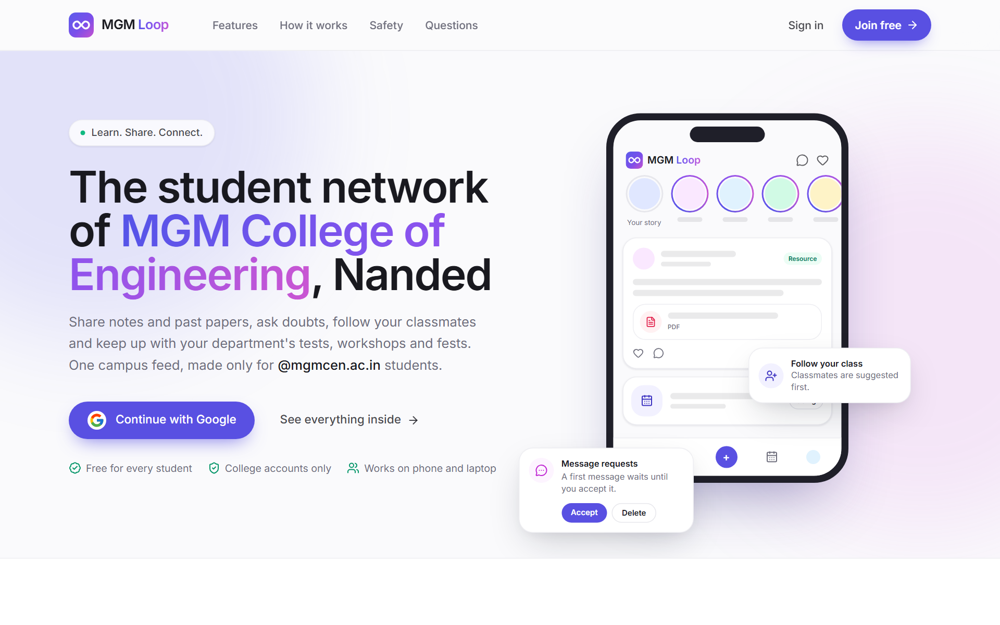
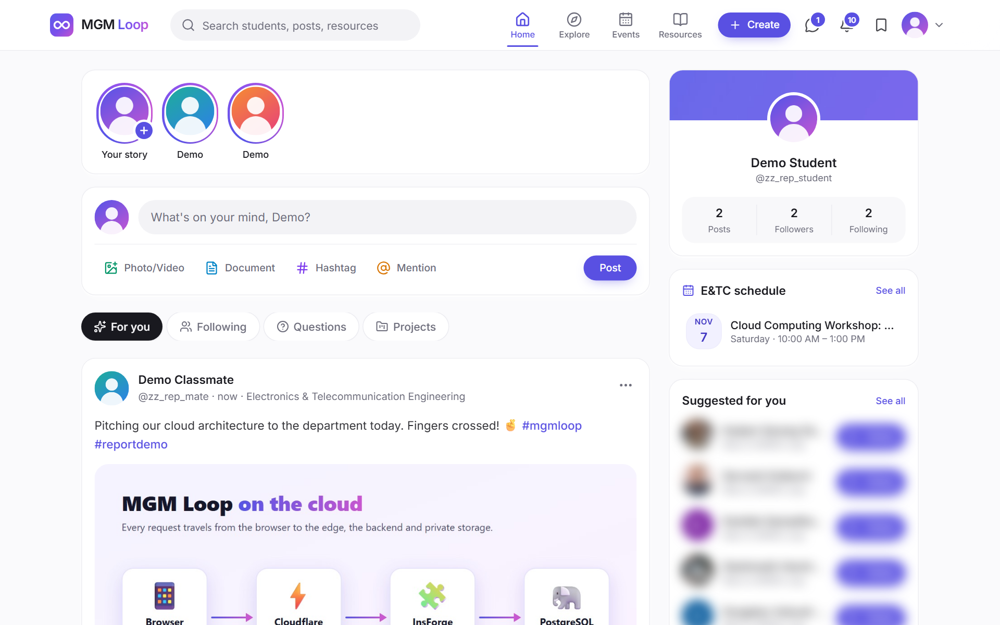
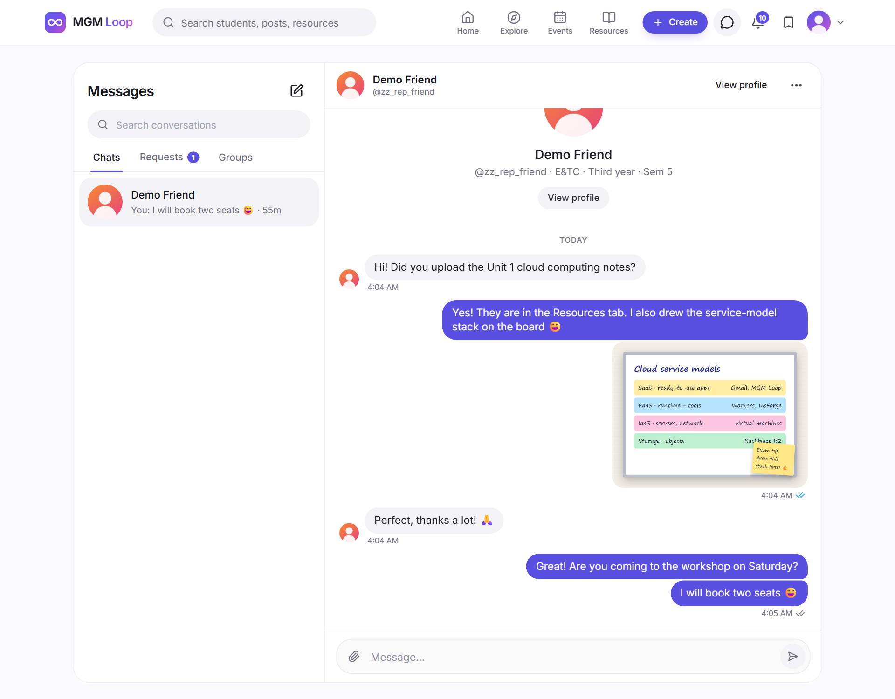
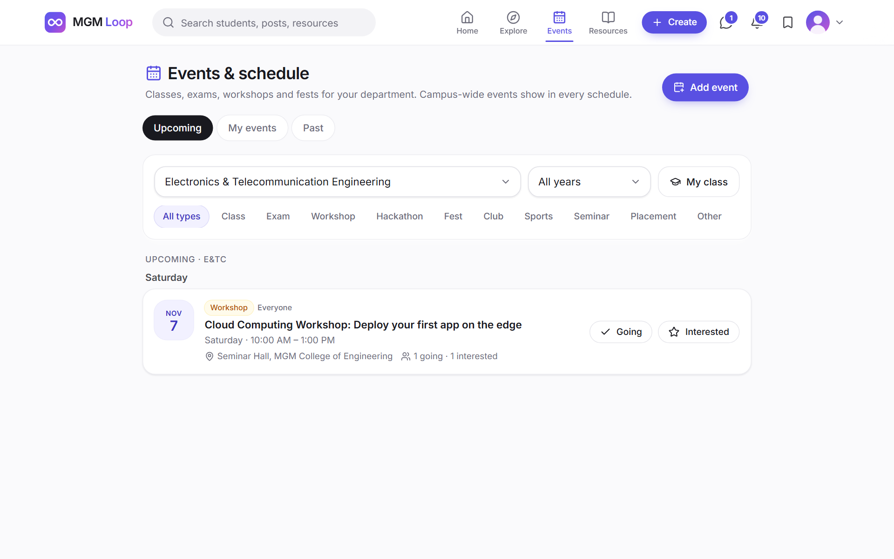
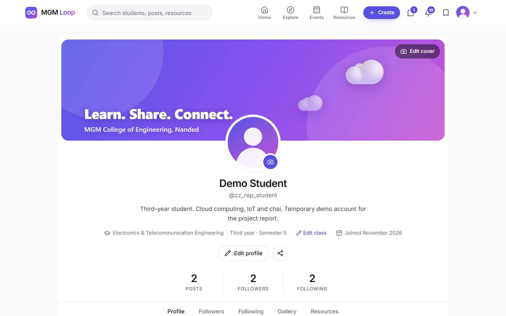
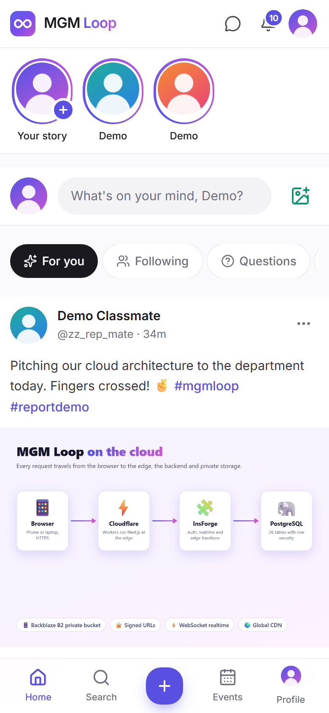
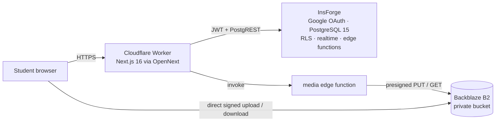
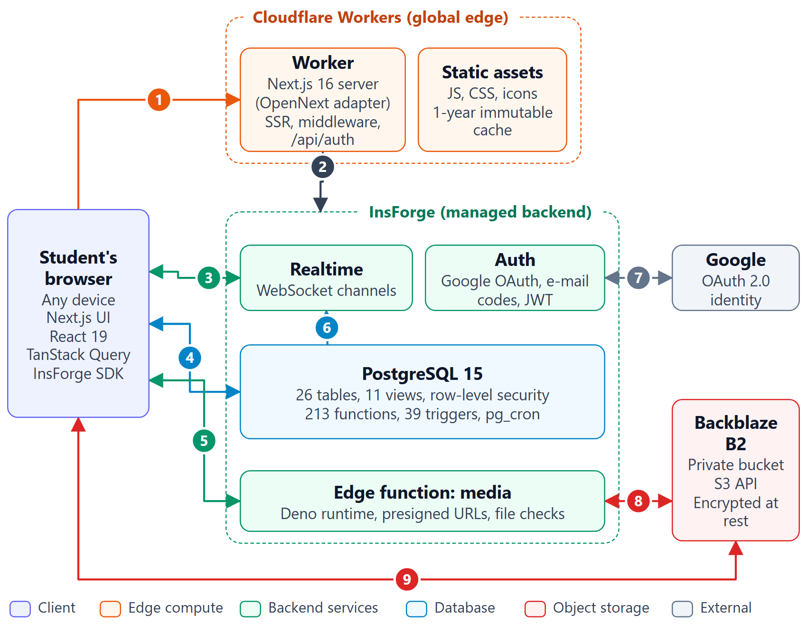

# MGM Loop

### Learn. Share. Connect.

A secure, real-time, serverless social learning network built for the students of
**MGM College of Engineering, Nanded**.

[Live platform](https://mgm-loop.vasu14gg.workers.dev) ·
[Project report](docs/MGM-Loop-Project-Report.pdf) ·
[Presentation](docs/MGM-Loop-Presentation.pdf) ·
[Screenshots](docs/screenshots) ·
[Source preview](source-preview)


> [!IMPORTANT]
> **This is a project showcase, not a runnable distribution.**
> The repository publishes the report, presentation, screenshots, diagrams and a **read-only source
> preview**. Build configuration, environment files, database migrations, the storage edge function
> and all admin/moderation management code are intentionally excluded. **The code will not install,
> build or run as-is.** See [Why the code is not runnable](#why-the-code-is-not-runnable).

---

## Project team

Department of Computer Science & Engineering · Academic Year 2026–27

| # | Name | Roll No. |
|---|------|----------|
| 1 | **Saran Kadam** | **124** |
| 2 | HarshVardhan Deshmukh | 140 |
| 3 | Chandrashekhar Kalyan | 148 |
| 4 | Sarvesh Kulkarni | 102 |
| 5 | Chaitanya Kowlar | 103 |
| 6 | Samadhan Kambhe | 128 |

## Deliverables

| Deliverable | Link | What is inside |
|-------------|------|----------------|
| **Project report** | [MGM-Loop-Project-Report.pdf](docs/MGM-Loop-Project-Report.pdf) | 82-page report: abstract, literature survey, system design, database, security, implementation, testing, results and future scope |
| **Presentation** | [MGM-Loop-Presentation.pdf](docs/MGM-Loop-Presentation.pdf) | 10-slide project presentation |
| **Editable report** | [MGM-Loop-Project-Report.docx](docs/MGM-Loop-Project-Report.docx) | Word source of the report |
| **Screenshots** | [docs/screenshots](docs/screenshots) | 49 screenshots of the student and moderation experience on phone, tablet and desktop |
| **Diagrams** | [docs/diagrams](docs/diagrams) | 20 architecture, DFD, ER, security, deployment and testing diagrams |
| **Source preview** | [source-preview](source-preview) | Read-only student-facing source code |

---

## What is MGM Loop?

MGM Loop is a **campus-only social learning network**. A student signs in with a verified
`@mgmcen.ac.in` Google account, chooses their department, year and semester, and enters a private
space built around their classmates rather than the public internet.

Inside, students share posts, questions, projects and study resources; follow each other; post
24-hour stories; ask and answer academic doubts; find notes and previous-year papers in a
department-wise library; message one-to-one or in groups with attachments and read receipts; follow
department events and RSVPs; and receive live notifications. A moderation console handles reports,
warnings, restrictions and suspensions with an append-only audit trail.

The project deliberately has **no server of its own**. The application runs on Cloudflare's edge,
the backend is InsForge (Google OAuth, PostgreSQL, realtime and edge functions), and every uploaded
file lives in a private Backblaze B2 bucket reached only through short-lived signed URLs.

### The problem

- Academic notes, papers and project files are scattered across messaging apps, drives and personal
  folders.
- Important class and department announcements get buried in noisy group chats.
- Finding a study partner or project collaborator is ad hoc and depends on who you already know.
- Public social networks mix verified campus information with unrelated content.
- Colleges do not own or moderate the spaces where much of student life actually happens.

### The solution

- **One verified campus identity.** Only college Google accounts can enter; the domain check is
  enforced in the browser, at the OAuth callback and inside the database.
- **One academic feed.** Posts, questions, projects and resources with photos, video and PDFs, ranked
  by class, department, relationships, engagement and freshness.
- **One resource library.** Notes, question papers, lab manuals and project reports organised by
  department, semester, subject and category.
- **One communication layer.** Message requests, personal chats, group chats, attachments, delivery
  and read receipts, story replies and live notifications.
- **One trusted space.** Reports, moderation, warnings, restrictions and an audit trail that records
  every administrative action with a reason.

---

## Features

| Area | What students can do |
|------|----------------------|
| **Identity & profiles** | Sign in with Google using a verified `@mgmcen.ac.in` account, complete onboarding, set a photo, cover and bio, and share department, year and semester |
| **Ranked feed** | Read posts, questions, projects and resources; like, comment, bookmark and share; follow classmates; discover trending hashtags and suggested people |
| **Academic library** | Browse and search notes, previous-year papers, lab manuals and project reports by department, semester, subject and category |
| **Stories** | Post 24-hour photo or video stories; see viewers, reactions and comments; reply privately to a story from the viewer |
| **Personal messaging** | Start with a one-message request, then chat with text, photos, videos and documents; delivery ticks, blue read receipts, retries and offline-safe sending |
| **Group chats** | Create groups, add members, share media and files, see who has read a message, and keep every member's view in sync in real time |
| **Events** | Follow a department-wise schedule of classes, tests, workshops, hackathons, fests and placement talks; mark Going or Interested and export to a calendar |
| **Notifications** | Live notifications for follows, likes, comments, mentions, messages, reports and moderation notices, grouped to avoid noise |
| **Search & discovery** | Search students, posts and resources; explore people and content beyond the immediate feed |
| **Trust & safety** | Report posts, comments, resources, messages, accounts and groups; moderators review each report and can warn, pause, restrict or suspend, always with a recorded reason |
| **Responsive by design** | One website for phones, tablets and computers: bottom tab bar, edge-to-edge media, swipe-to-close sheets, keyboard-aware chats, safe-area padding and touch gestures |

---

## A look inside

| Landing page | Student home feed | Personal chat |
|--------------|-------------------|---------------|
|  |  |  |

| Events | Student profile | Phone experience |
|--------|-----------------|------------------|
|  |  |  |

More screenshots: [docs/screenshots](docs/screenshots).

---

## Architecture

MGM Loop is assembled from managed cloud services. The browser talks directly to InsForge with the
signed-in student's token; there is no custom API server to patch, scale or misconfigure.





### How a request flows

1. Cloudflare serves the Next.js application from its edge network over HTTPS.
2. The app authenticates the student through Google OAuth and InsForge, then keeps the session in
   secure cookies.
3. Data reads and writes go to InsForge's PostgreSQL database with the student's JWT. Row-level
   security and `SECURITY DEFINER` functions decide what that student may read or write.
4. Database triggers maintain counters, hashtags, mentions, notifications and realtime events.
5. The `media` edge function issues short-lived signed URLs to Backblaze B2 only after the database
   confirms the student may upload, read or delete a particular object.
6. The browser uploads and downloads files directly to and from B2; file bytes never pass through
   the application server.

### Files and media

Every upload is reserved in the database before it exists, uploaded directly to a private bucket,
and confirmed by checking its size and first bytes. The database stores the owner, original name,
object key, MIME type, size, purpose, links and status. Downloads are signed per file and per student.
Deleting a post, story, photo or message queues its objects for deletion; a daily sweep retries
anything left behind and removes abandoned uploads.

### Ranking

The ranked feed scores recent posts by relationship (your own posts, people you follow, same class
or department, past interactions), relevance (resources and questions for your semester), engagement
(likes and comments, log-scaled) and freshness, while spreading authors out so one person cannot fill
the feed.

---

## Technology

| Layer | Technology | Role |
|-------|------------|------|
| **UI** | Next.js 16 App Router, React 19, TypeScript 5.9 | Server-rendered pages, client components, routing |
| **Styling** | Tailwind CSS 3.4, Radix primitives, Lucide icons | Responsive design system and accessible UI primitives |
| **Data fetching** | TanStack Query 5 | Caching, background refresh and optimistic updates |
| **Auth** | InsForge + Google OAuth (PKCE) | College-account sign-in and session refresh |
| **Database** | PostgreSQL 15 on InsForge | 26 tables, 11 views, 213 functions, row-level security |
| **Realtime** | InsForge channels | Feed, post, notification, inbox, group and admin events |
| **Files** | Backblaze B2 + InsForge edge function | Private object storage and short-lived signed URLs |
| **Hosting** | Cloudflare Workers + OpenNext | Global edge deployment, HTTPS and CDN |
| **Tooling** | Wrangler, InsForge CLI, Git, GitHub | Build, migrations, deployment and review |

### Cloud services

| Service | What it provides |
|---------|------------------|
| **Cloudflare Workers** | Runs the Next.js application at the edge, terminates HTTPS and serves static assets from the CDN |
| **InsForge** | Google authentication, PostgreSQL with row-level security, realtime channels, the `media` edge function and scheduled clean-up |
| **Backblaze B2** | A private bucket for avatars, covers, post media, stories, event covers, group attachments, PDFs and documents |
| **GitHub** | Source control, review and the project showcase you are reading |

---

## By the numbers

| Metric | Value |
|--------|-------|
| Application | 153 TypeScript/TSX files, 22,119 lines, 32 pages, 3 API route handlers |
| Database | PostgreSQL 15.18: 26 tables, 11 views, 213 functions, 27 row-level security policies, 39 triggers, 122 indexes and 59 foreign keys |
| Migrations | 11 SQL migrations, 8,421 lines |
| Media edge function | About 610 lines of Deno/TypeScript |
| Automated checks | 153 acceptance, access-control, layout and deployment checks passed |
| Performance | Median load time of 1.2 s across 45 measured page loads |
| Report | 82 pages |
| Presentation | 10 slides |

---

## Security and privacy

- **College accounts only.** A verified `@mgmcen.ac.in` Google account is required. The domain is
  checked during OAuth, again when a profile is created, and inside database policies.
- **Authorization in the database.** Every table is protected by row-level security. Students do not
  write tables directly; they call functions that check identity, role and restrictions first. A
  table with no policy denies access by default.
- **Private files.** The B2 bucket is private. The browser receives only short-lived signed URLs, and
  only after the database confirms the student may read that object.
- **Upload validation.** File type, size, per-student quotas and the declared MIME type are checked;
  the object's first bytes are read on confirmation so an HTML file cannot masquerade as an image.
- **Admin separation.** The administrator role is stored in the database and matched against the
  verified email. Admin sessions are time-limited; each action needs a reason and is written to an
  append-only audit log. Every admin function re-checks the role and session.
- **Secrets stay server-side.** Backblaze credentials exist only as InsForge function secrets. No
  secret is in the browser bundle, the repository or the Cloudflare configuration.
- **Safe defaults.** HTTPS, `httpOnly` cookies, security headers, a strict CORS allow-list on the
  bucket, pinned dependencies and a lock file.

---

## Testing and results

The system was tested on the deployed site, not only on a local copy, because the behaviour of the
cloud services is part of what is being tested.

| Area | Result |
|------|--------|
| Functional acceptance | 153 automated checks passed across sign-in, onboarding, feed, posts, search, stories, events, profiles, notifications, personal chats, group chats, reporting and administration |
| Access control | Non-college accounts rejected; direct table access denied; admin functions refused without a valid role and session |
| Responsive layout | Phone, tablet and desktop layouts verified with screenshots, including touch gestures and keyboard behaviour |
| Performance | Median load time 1.2 s across 45 measured page loads; Worker CPU time recorded separately |
| Data protection | Temporary test accounts and their data were removed after the screenshot and test runs |

The full test cases, screenshots, measurements, defects found and limitations are in
[Chapter 5 of the report](docs/MGM-Loop-Project-Report.pdf).

---

## Repository map

```text
.
├── README.md
├── LICENSE
├── docs/
│   ├── MGM-Loop-Project-Report.pdf      # 82-page project report
│   ├── MGM-Loop-Project-Report.docx     # editable report source
│   ├── MGM-Loop-Presentation.pdf        # 10-slide presentation
│   ├── diagrams/                        # 20 design and architecture diagrams
│   └── screenshots/                     # 49 screenshots of the product
└── source-preview/
    ├── README.md
    ├── public/
    │   └── llms.txt
    └── src/                             # student-facing application code
        ├── app/
        ├── components/
        ├── lib/
        └── middleware.ts
```

---

## Why the code is not runnable

The source preview is a **reading copy**, not a release. The following are deliberately not
published:

- **Build and dependency files:** `package.json`, `package-lock.json`, `tsconfig.json`,
  `next.config.ts`, `postcss.config.mjs`, `tailwind.config.ts`.
- **Environment and deployment:** `.env`, `.env.local`, `.env.example`, `.insforge/`,
  `wrangler.jsonc`, `open-next.config.ts`, `insforge.toml`.
- **Backend:** the `migrations/` directory (all SQL schema, policies and functions) and
  `insforge/functions/media.ts`.
- **Management code:** `src/app/admin/`, `src/components/admin/`, `src/lib/admin-api.ts`,
  `src/app/actions/admin.ts` and the `/choose-role` route.
- **Operations notes:** `DEPLOYMENT.md` and `AGENTS.md`.

There is no installable package, no database schema, no storage function, no environment and no
admin console. Copying the files does not produce a working MGM Loop. The full working tree and the
management modules remain private.

---

## Limitations and future scope

- The application is a responsive web app; native apps and push notifications outside the browser
  are out of scope.
- Voice and video calls, payments and automated content moderation are not implemented.
- The deployment runs on free or low-cost tiers, so storage, bandwidth, Worker CPU and request limits
  apply as the user base grows.
- Planned campus features include study circles, a project-partner finder, an internship board and
  deeper event discovery.
- Authentication hardening includes disabling unused sign-up methods at the provider and adding
  stronger device/session management.

---

## Academic context

This project was carried out as a **Cloud Computing Pedagogical Initiatives mini project** in the
Department of Computer Science & Engineering, **Mahatma Gandhi Mission's College of Engineering,
Nanded**, affiliated with **Dr. Babasaheb Ambedkar Technological University, Lonere**, for the
academic year **2026–27**.

The report and presentation are the authoritative deliverables. The live deployment is kept for the
college community; public visitors can see the landing page, while the signed-in area is restricted
to verified `@mgmcen.ac.in` accounts.

---

## License and use

**All rights reserved.**

This repository is an academic project showcase. No permission is granted to copy, modify,
redistribute, deploy or use this project or its source code, in whole or in part, without the written
permission of the authors. The code is published for viewing and evaluation only. The absence of
build configuration, database migrations and management modules is intentional.

© 2026 Saran Kadam, HarshVardhan Deshmukh, Chandrashekhar Kalyan, Sarvesh Kulkarni, Chaitanya Kowlar
and Samadhan Kambhe.

---

## Contact

**Saran Kadam** · GitHub: [@sarang-sketch](https://github.com/sarang-sketch)

Built at MGM's College of Engineering, Nanded · 2026–27
